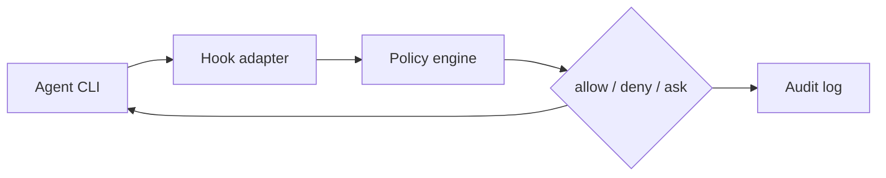

# Architecture

© 2026 Privaku

The agent CLI is Claude Code, Codex, or Cursor. The hook adapter is `agent-shield hook`. The policy engine is `shield-core`. The decision is Allow, Deny, or Ask. The log is the hash-chained JSONL file written by `shield-audit`.

## Crates

| Crate | Role |
| --- | --- |
| `shield-core` | Action model, YAML policy loader, shell parser, path and secret checks, risk scorer |
| `agent-shield` | CLI, hook adapters, install, `check`, `doctor` |
| `shield-ipc` | Local approval daemon and its JSON-lines protocol |
| `shield-mcp` | MCP stdio proxy |
| `shield-audit` | Hash-chained audit log |
| `fake-mcp-server` | Test double used by the proxy tests |

## Evaluation

1. The hook or `check` builds an action: shell, file read, or MCP tool call.
2. The loader merges three layers. Later layers override earlier ones: the embedded `rules/default.yaml`, then `~/.config/privaku/agent-shield/policy.yaml`, then `./.agent-shield.yaml`.
3. Matching rules combine with Deny beating Ask beating Allow.
4. A risk score at or above `ask_threshold` (default `0.70`) can raise an Allow to an Ask. It does not lower a Deny or an Ask.
5. The decision is printed and appended to the log.

If the policy fails to load, the caller denies the action.

## Ask

An Ask does not wait inside `check`. The hook path can ask the local daemon (`agent-shield daemon`). `agent-shield approve` is the terminal UI for that daemon. Keys for a scripted UI are `a`, `s`, `A`, and `d` (`agent-shield approve --help`). The daemon listens on a Unix socket. It does not listen on a TCP port.

Default Ask timeout is 30 seconds (`ask_timeout_seconds`). On timeout, and when no UI is available, the default is Deny. `on_timeout: allow` and `on_no_ui: allow` are rejected.

## What is outside this repository

The macOS menu-bar app is a separate download. This core does not include that app or a network filter. See the [README](../README.md).
