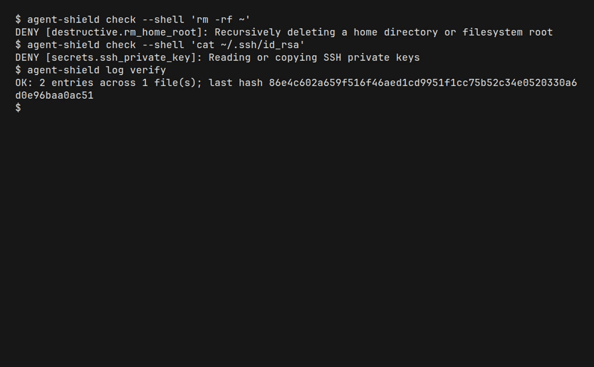

# Troubleshooting

© 2026 Privaku

## doctor

```bash
agent-shield doctor
agent-shield doctor --json
```

The text report starts with `Agent Shield doctor` and one bracketed status per check. Status words are `OK`, `WARN`, and `ERROR`.

A healthy policy line looks like:

```text
[OK   ] Policy: policy v1 is valid (20 enabled rules)
```

Hook lines name the file that was checked:

```text
[WARN ] claude hooks: agent installation was not detected (/home/you/.claude/settings.json)
```

That warning means the Claude config directory is absent, so `install --all` will skip Claude. Create the agent's own config directory first, or pass `--claude` only after `~/.claude` exists. `install` treats an agent as detected when its config path or parent directory exists.

`[WARN ] Daemon: daemon is not running` means nothing is listening on the approval socket. Start one with:

```bash
agent-shield daemon --foreground
```

The socket path is `$AGENT_SHIELD_SOCK` when set. Otherwise it is `$XDG_RUNTIME_DIR/privaku/agent-shield.sock`, or `/tmp/privaku-<uid>/agent-shield.sock` when `XDG_RUNTIME_DIR` is unset. On macOS it is `~/Library/Application Support/Privaku/agent-shield.sock`.

## Every action is denied

If the policy file does not parse, `rules list` prints:

```text
error: ...
The policy did not load; every action is denied until this is fixed.
```

`rules validate` exits 1 and prints `error:` for an invalid file. A valid file prints `OK:` with the rule counts. Fix the YAML, then run `agent-shield check` again.

`HOME` must be set. The audit log cannot be created without it unless `AGENT_SHIELD_STATE_DIR` points at a writable directory.

## Audit log

```bash
agent-shield log verify
agent-shield log tail -n 20
agent-shield log tail --decision deny
agent-shield log export --since 2026-10-18T00:00:00Z
```

`log verify` prints `OK: <n> entries across <n> file(s); last hash <sha256>` when the chain matches.



`log tail` prints one JSON object per line:

 A tampered line prints `error:` and a hash mismatch. `check` and the hooks append a line on each decision, so a verify failure means the file changed after it was written.

Default log directory:

- `AGENT_SHIELD_STATE_DIR` if set
- otherwise `$XDG_STATE_HOME/privaku` on Linux, or `~/.local/state/privaku`
- on macOS, `~/Library/Logs/Privaku/agent-shield`

The active file is `audit.jsonl`.

## Exit codes from check

| Code | Meaning |
| --- | --- |
| 0 | Allow |
| 10 | Ask |
| 20 | Deny |
| 2 | Bad usage, or an unsupported hook agent |

`agent-shield check` requires exactly one of `--shell`, `--read`, or `--mcp`.

## Hooks that do not fire

1. Run `agent-shield doctor` and read the hook line for that agent.
2. Confirm the command in the config is the absolute path of the `agent-shield` you expect. Reinstall after moving the binary: `agent-shield install --claude` (or `--cursor`, `--codex`).
3. For Cursor, `failClosed` must stay `true`. The installer sets it. If a hook crashes, Cursor blocks the tool call instead of running it.
4. `agent-shield hook cursor --event` is rejected for `claude` and `codex`.

## rules test

`agent-shield rules test` prints `Rules test: not yet implemented (M6)`. Evaluate an action with `agent-shield check` instead.
